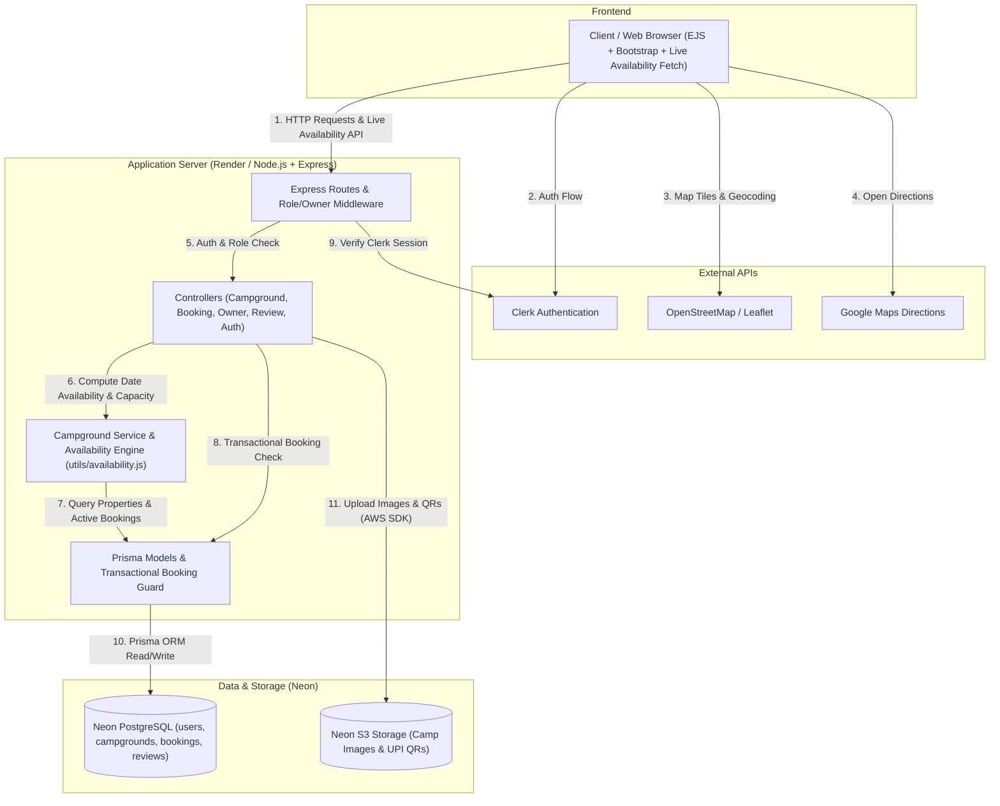

# 🏕️ CampVista


**Live Demo:** [https://camp-vista.onrender.com/](https://camp-vista.onrender.com/)

CampVista is a modern, full-stack campground booking and review platform. It connects outdoor enthusiasts with unique camping spots, allowing users to discover, review, and book campgrounds effortlessly. Campground owners can list their properties, manage bookings, and accept direct payments via QR codes.

---

## 🚀 Features

* **User Authentication:** Secure signup and login powered by Clerk.
* **Role-Based Access Control:** Distinct roles for Customers, Campground Owners, and Admins.
* **Interactive Maps:** View campgrounds on a map, get distances from your current location, and instantly launch Google Maps directions.
* **Room Availability & Capacity Tracking:** Owners define total rooms (`total_rooms`) and maximum guests allowed per room (`room_capacity`) when registering or editing a property. Listings display live date-based room counts (and clearly indicate when no rooms are available).
* **Booking Engine:** Select check-in/check-out dates, enforce per-room guest limits, calculate dynamic pricing, and reserve rooms safely with transactional availability checks (`createIfRoomAvailable`).
* **Owner Dashboard:** Hosts can monitor property room availability alongside customer reservation requests and approve or reject bookings.
* **QR Code Payments:** Owners can upload their personal UPI/Payment QR codes for customers to scan and pay directly.
* **Reviews & Ratings:** Users can leave authentic reviews and ratings for campgrounds they've visited.
* **Cloud Storage:** High-performance, S3-compatible cloud storage for campground images and QR codes.

---

## 🛠️ Tech Stack

* **Frontend:** HTML, CSS, JavaScript, EJS (Embedded JavaScript templates), Bootstrap 5, Leaflet.js
* **Backend:** Node.js, Express.js
* **Database:** Neon Serverless PostgreSQL
* **ORM:** Prisma
* **Authentication:** Clerk
* **Storage:** Neon Object Storage (S3-Compatible)
* **Hosting:** Render (Web Service)

---

## 🏗️ High-Level Design (HLD)

The architecture follows a stateless, layered MVC + Service backend pattern with managed external services for database, authentication, and object storage.



### Components:
1. **Client Browser:** Renders EJS views, handles user geolocation, queries `GET /campgrounds/:id/availability` dynamically when dates change, enforces per-room guest selector limits, and interfaces with Clerk for auth states.
2. **Routes & Middleware (`routes/`, `middleware/`):** Handles authentication (`isLoggedIn`), role checks (`isRole`), and property ownership checks (`isOwner`).
3. **Controllers (`controllers/`):** Processes requests for properties, bookings (`showPaymentPage` and `confirmPayment` validate `room_capacity` and room availability), reviews, and the host management dashboard (`ownerController`).
4. **Service & Availability Engine (`services/campgroundService.js`, `utils/availability.js`):** Resolves date ranges (`[check_in, check_out)` or default `[today, tomorrow)`), detects overlapping non-cancelled bookings, and computes `available_rooms` and `booked_rooms` against `total_rooms` and `room_capacity`.
5. **Models & Transactions (`models/`):** Interfaces with PostgreSQL via Prisma ORM, including `bookingModel.createIfRoomAvailable` which wraps availability verification and booking creation in a database transaction (`prisma.$transaction`) to prevent overbooking.
6. **Clerk:** Manages users, sign-in/sign-up widgets, and session tokens.
7. **Neon PostgreSQL:** Primary relational database containing `users`, `campgrounds` (including `total_rooms` and `room_capacity`), `bookings`, and `reviews`, with startup schema verification in `app.js`.
8. **Neon S3 Storage:** Object storage bucket holding uploaded campground cover images and host UPI QR codes.

---

## ⚙️ Local Development Setup

To run CampVista locally, follow these steps:

### 1. Clone the repository
```bash
git clone https://github.com/yourusername/CampVista.git
cd CampVista
```

### 2. Install dependencies
```bash
npm install
```

### 3. Configure Environment Variables
Create a `.env` file in the root directory and add your secret keys:
```env
# Database
DATABASE_URL="postgres://[user]:[password]@[neon-host]/neondb"

# Clerk Auth
CLERK_PUBLISHABLE_KEY="pk_test_..."
CLERK_SECRET_KEY="sk_test_..."

# Neon S3 Storage
AWS_ENDPOINT_URL_S3="https://[your-neon-storage-url]"
AWS_ACCESS_KEY_ID="[your-access-key]"
AWS_SECRET_ACCESS_KEY="[your-secret-key]"
AWS_REGION="us-east-2"
```

### 4. Sync Database Schema
Generate the Prisma client and push the schema to your Neon database:
```bash
npx prisma generate
npx prisma db push
```

### 5. Start the Server
```bash
npm run dev
```
Your application will be running at `http://localhost:3000`.

---

## 📄 License
This project is licensed under the MIT License.
